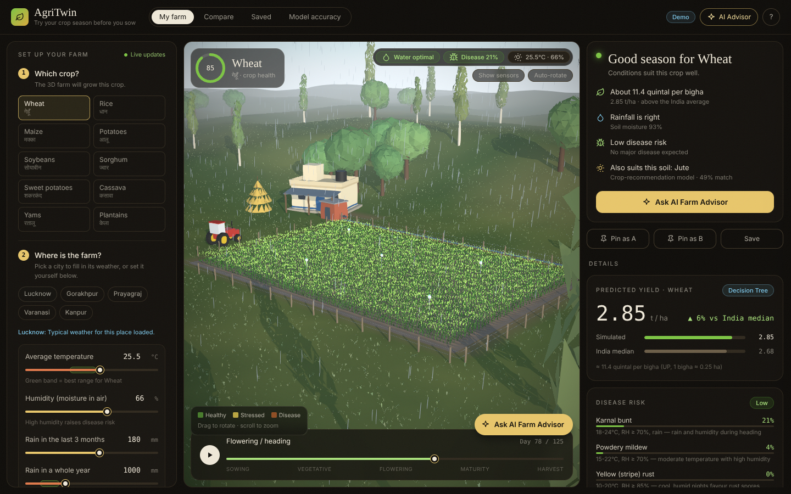
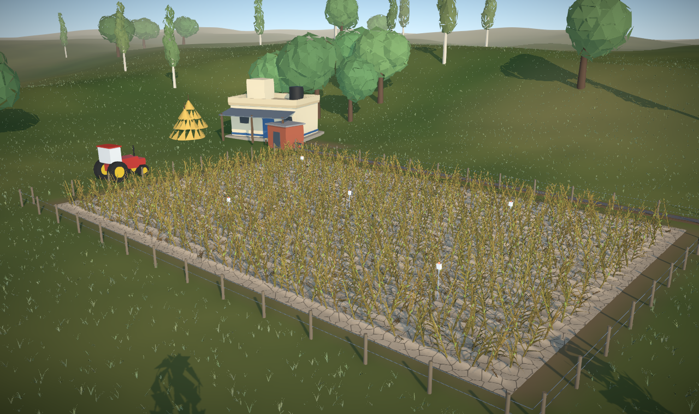
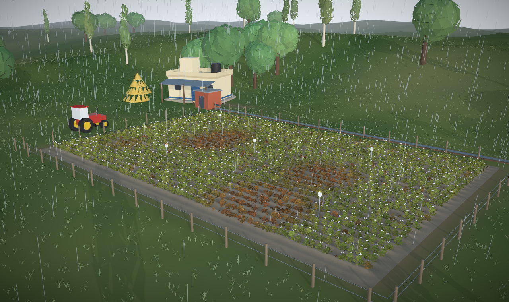
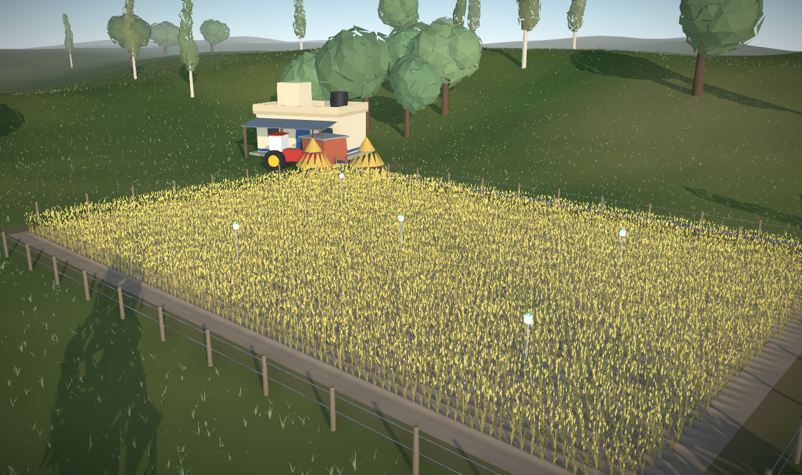
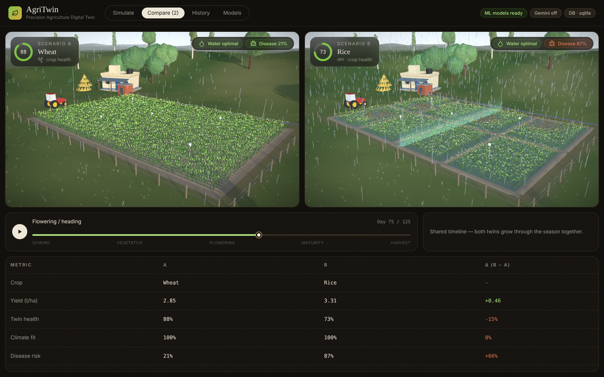
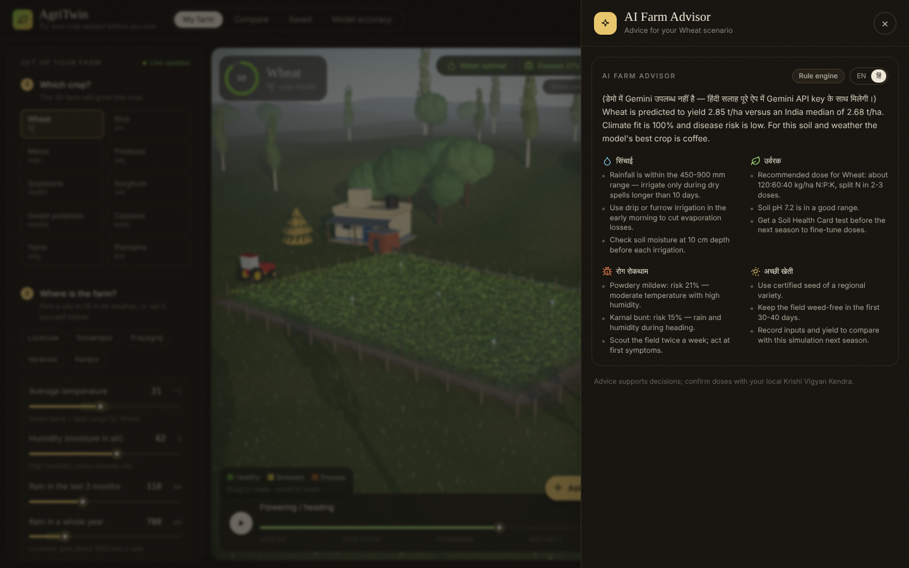
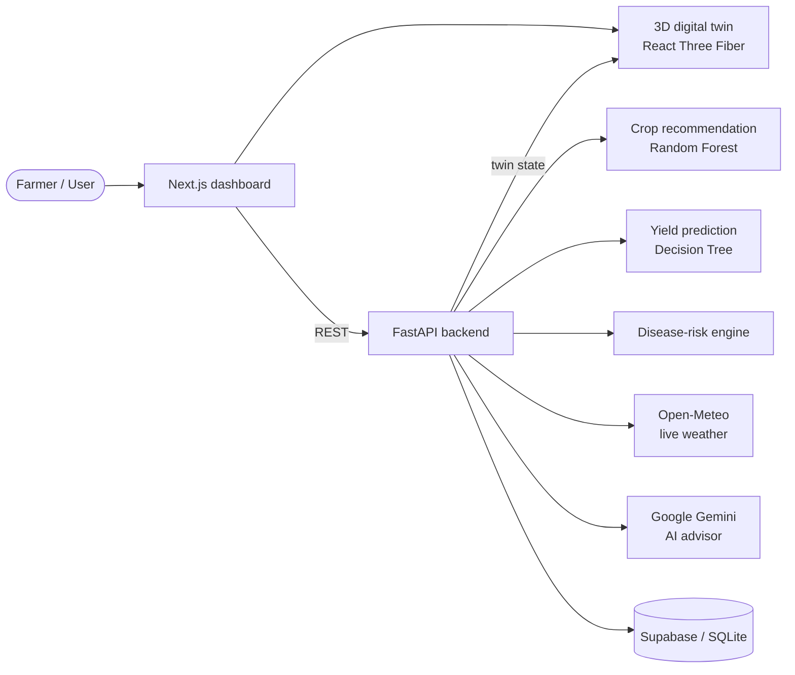

<div align="center">

# 🌾 AgriTwin

### Precision Agriculture Digital Twin for AI-Driven Crop Simulation and Decision Support

**Try a crop season on a virtual farm before you sow the real one.**




</div>

---

## About

Farmers usually commit seed, water and fertilizer before they know how a season will turn out. **AgriTwin** builds a virtual copy of a farm, a *digital twin*, so you can change the weather, soil and crop and see the likely result first.

You pick a crop, a location and a soil type. Two machine-learning models predict the best crop and the expected yield, a rule engine estimates disease risk, and Google Gemini explains it all as practical advice in English or Hindi. The 3D farm grows, wilts, floods or gets diseased to match the prediction.

> Built as an NTCC project at **Amity School of Engineering and Technology, Amity University Uttar Pradesh, Lucknow**.

---

## Features

| | Feature | What it does |
|---|---|---|
| 🌱 | **Interactive 3D digital twin** | Procedural farm with 10 crop types (wheat, rice paddy, maize, potato, soybean and more). Thousands of plants sway in the wind and change colour, height and density with crop health. |
| 📅 | **Growing-season timeline** | Press play to watch the crop grow from sowing to harvest. Wheat and rice turn golden at maturity. |
| 🌦️ | **Weather that shows** | Low rainfall cracks the soil and wilts plants. Heavy rain brings clouds and rainfall. Rice grows in flooded plots with bunds. |
| 🦠 | **Disease-risk engine** | Crop-specific risk for diseases such as wheat rust, rice blast and potato late blight, shown as brown patches on the 3D field. |
| 🤖 | **Crop recommendation** | Random Forest model suggests the best crop for the soil (N, P, K, pH) and weather. |
| 📈 | **Yield prediction** | Decision Tree model predicts yield in t/ha and quintal per bigha, compared with the India average. |
| ✨ | **AI Farm Advisor** | Gemini gives irrigation, fertilizer, disease-prevention and best-practice advice in **English or Hindi**. Falls back to a rule engine without an API key. |
| 📍 | **Live weather** | Pick a city or search any village. Open-Meteo fills in temperature, humidity and rainfall. |
| ⚖️ | **Scenario compare** | Pin two scenarios and watch both farms grow side by side, with a table of differences. |
| 💾 | **Saved history** | Save simulations to Supabase (or local SQLite) and reload them later. |
| 🧭 | **Made for first-time users** | Step-by-step inputs, soil-type presets instead of lab numbers, plain-language verdict and a built-in guide. |

---

## Screenshots

| Drought-stressed maize | Diseased potato in rain |
|---|---|
|  |  |

| Ripe wheat at harvest | Two scenarios compared |
|---|---|
|  |  |

<p align="center"></p>

---

## How it works



1. **Input:** crop, location (live weather) and soil type.
2. **Predict:** the Random Forest recommends a crop, and the Decision Tree predicts yield.
3. **Assess:** the rule engine scores disease risk, climate fit and water balance.
4. **Visualise:** these combine into a *twin state* (health, moisture, disease, vigour) that drives the 3D farm.
5. **Advise:** Gemini turns the numbers into practical steps.

---

## Machine-learning models

| Task | Dataset | Model used | Result |
|---|---|---|---|
| Crop recommendation | [Kaggle Crop Recommendation](https://www.kaggle.com/datasets/atharvaingle/crop-recommendation-dataset): 2,200 rows, 22 crops | Random Forest | **99.55 %** accuracy, F1 0.9955 |
| Yield prediction | [Kaggle Crop Yield Prediction](https://www.kaggle.com/datasets/patelris/crop-yield-prediction-dataset) (FAO + World Bank): 28,242 rows, 10 crops | Decision Tree | **R² 0.979**, MAE 3,769 hg/ha |

`ml/train.py` compares 6 classifiers and 5 regressors and saves every score to `backend/models/metrics.json`.

---

## Tech stack

| Layer | Technology |
|---|---|
| Frontend | Next.js 14, React 18, TypeScript, Tailwind CSS |
| 3D visualisation | Three.js, React Three Fiber, Drei, post-processing (ambient occlusion, bloom) |
| Backend | FastAPI, Pydantic, Uvicorn |
| Machine learning | scikit-learn, pandas, Joblib |
| Generative AI | Google Gemini 2.5 Flash (`google-genai`) |
| Weather | Open-Meteo API (free, no key) |
| Database | Supabase (PostgreSQL), with SQLite fallback |

---

## Getting started

### Prerequisites
- **Python 3.10+**
- **Node.js 18+**
- A free **Gemini API key** from [Google AI Studio](https://aistudio.google.com/apikey) (optional but recommended)

### 1. Clone
```bash
git clone https://github.com/PranjalPV/AgriTwin.git
cd AgriTwin
```

### 2. Start the backend
```bash
cd backend
python -m venv .venv
# Windows
.venv\Scripts\activate
# macOS / Linux
source .venv/bin/activate

pip install -r requirements.txt
cp .env.example .env        # Windows: copy .env.example .env
uvicorn app.main:app --reload --port 8000
```
API docs open at **http://localhost:8000/docs**.

### 3. Start the frontend (new terminal)
```bash
cd frontend
npm install
npm run dev
```
Open **http://localhost:3000**.

### 4. Configure (optional)

Edit `backend/.env`:

| Variable | Purpose |
|---|---|
| `GEMINI_API_KEY` | Enables the AI Farm Advisor and Hindi advice. Without it, built-in rules are used. |
| `GEMINI_MODEL` | Defaults to `gemini-2.5-flash`. |
| `SUPABASE_URL`, `SUPABASE_KEY` | Store history in Supabase. Run `backend/supabase_schema.sql` first. Without them, SQLite is used. |

> The trained models are already included. To retrain, run `python ml/train.py` from the project root (about 1 minute).

---

## Using AgriTwin

1. **Pick a crop.** The 3D farm switches to it.
2. **Pick a city** (Lucknow, Gorakhpur, Prayagraj…) to load its weather, or move the sliders.
3. **Pick a soil type**, or enter your Soil Health Card values.
4. Read the **verdict card**: season quality, expected harvest, water and disease risk.
5. Click **Ask AI Farm Advisor** for what to do. Switch to **हिं** for Hindi.
6. Press **▶** to play the season, and drag to rotate the farm.
7. **Pin as A**, change something, **Pin as B**, then open **Compare**.

**Things to try:** set yearly rain to 200 mm to see drought, raise humidity to 95 % to see disease, or pick Rice to see flooded paddy plots.

---

## API reference

| Method | Endpoint | Description |
|---|---|---|
| `GET` | `/api/health` | Server status and active integrations |
| `GET` | `/api/meta` | Crops, countries and default values |
| `GET` | `/api/geocode?q=` | Search a place by name |
| `GET` | `/api/weather?lat=&lon=` | Live weather turned into model inputs |
| `POST` | `/api/simulate?save=` | Run both models, disease risk and twin state |
| `POST` | `/api/advice` | AI advice for a simulation (`lang`: `en` / `hi`) |
| `GET` | `/api/history` | Last 20 saved simulations |

Interactive docs are at `/docs` while the backend runs.

---

## Project structure

```
AgriTwin/
├── backend/
│   ├── app/
│   │   ├── main.py          # FastAPI routes
│   │   ├── engine.py        # ML predictions + twin state
│   │   ├── agronomy.py      # crop ranges, disease windows
│   │   ├── advisor.py       # Gemini + rule-based advice
│   │   ├── weather.py       # Open-Meteo integration
│   │   └── store.py         # Supabase / SQLite history
│   ├── models/              # trained .joblib models + metrics
│   └── requirements.txt
├── frontend/
│   ├── app/                 # Next.js pages
│   ├── components/
│   │   ├── twin/            # 3D digital twin (field, scenery, weather)
│   │   ├── Controls.tsx     # step-by-step inputs
│   │   ├── Results.tsx      # verdict and result cards
│   │   └── Overlays.tsx     # AI advisor panel, guide
│   └── lib/                 # API client, in-browser demo engine
├── ml/train.py              # model training and comparison
├── data/                    # Kaggle datasets
└── docs/                    # architecture, plan, screenshots
```

---

## Limitations

This is a **working prototype** for academic use:

- The yield data is country-level and global (1990–2013), not field-level Indian data.
- The sensor nodes in the 3D farm show simulated readings; no real hardware is connected.
- Disease risk and soil presets are rule-based and have not been checked against real field results.
- Advice supports decisions but does not replace an agronomist or Krishi Vigyan Kendra.

## Future scope

- IoT soil sensors and satellite imagery for real-time sync
- Leaf-photo disease detection using CNN or Gemini Vision
- Profit estimate using MSP and input costs
- District-level Indian yield data and regional models
- Mobile app and Hindi voice input

---

## Team

| | |
|---|---|
| **Developers** | Prasoon Kundu · Pranjal ([@PranjalPV](https://github.com/PranjalPV)) |
| **Faculty guide** | Dr. Neha Chauhan, Amity School of Engineering and Technology |
| **Institution** | Amity University Uttar Pradesh, Lucknow |

<div align="center">
<sub>Made with 🌱 for Indian farmers</sub>
</div>
