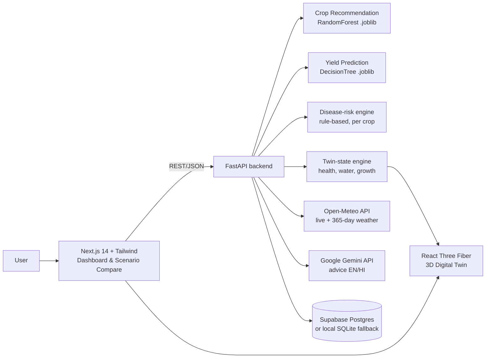

# AgriTwin — Architecture

Precision Agriculture Digital Twin Platform for AI-Driven Crop Simulation and Decision Support.

## 1. Datasets (verified, bundled in `data/`)

| Dataset | File | Rows | Columns used | Model |
|---|---|---|---|---|
| Kaggle *Crop Recommendation* (Atharva Ingle) | `crop_recommendation.csv` | 2,200 | N, P, K, temperature, humidity, ph, rainfall → label (22 crops) | Random Forest classifier |
| Kaggle *Crop Yield Prediction* (Rishit Patel; FAO + World Bank) | `yield_df.csv` | 28,242 (4,048 India) | Item (crop), Area (country), Year, average_rain_fall_mm_per_year, pesticides_tonnes, avg_temp → hg/ha_yield (10 crops) | Decision Tree regressor |

**Note for the report:** the yield dataset has no humidity or soil-type columns. Slide 9's feature list must read:
*Crop type, Country, Year, Annual rainfall, Average temperature, Pesticide use*.

## 2. System diagram



## 3. Components

| Layer | Tech | Responsibility |
|---|---|---|
| Frontend | Next.js 14 (App Router), TypeScript, Tailwind | Input panel, results cards, scenario A/B compare, history |
| Digital Twin | three.js, @react-three/fiber, drei, postprocessing | Procedural 3D farm: ~6k instanced plants with wind-sway shader, 4 crop morphologies, soil moisture/cracking, paddy water, rain, sun angle, disease patches, growth-stage timeline |
| Backend | FastAPI, Pydantic | Validation, orchestration, REST API |
| ML | scikit-learn, Joblib | Training script compares 6 classifiers / 5 regressors, saves best + metrics |
| Rules | Python | Disease risk (literature temperature/humidity windows), twin health score |
| GenAI | google-genai (Gemini 2.5 Flash) | Structured JSON advice: irrigation, fertilizer, disease, practices. Rule-based fallback if no key |
| Weather | Open-Meteo (free, no key) | Current temp/humidity, 90-day and 365-day rainfall sums |
| Storage | Supabase (PostgREST) / SQLite | Simulation history |

## 4. API contract

| Method | Path | Purpose |
|---|---|---|
| GET | `/api/health` | Liveness + which integrations are active |
| GET | `/api/meta` | Crop lists, countries, input ranges, model metrics |
| GET | `/api/weather?lat=&lon=` | Live weather → prefilled inputs |
| POST | `/api/simulate` | Runs both models + disease + twin state; saves to history |
| POST | `/api/advice` | Gemini (or fallback) advice for a simulation result |
| GET | `/api/history` | Last 20 simulations |

`POST /api/simulate` request:
```json
{ "N":90,"P":42,"K":43,"ph":6.5,"temperature":26,"humidity":80,
  "season_rainfall":200,"annual_rainfall":1083,"pesticides":40000,
  "crop":"Wheat","country":"India","year":2013 }
```
Response (abridged):
```json
{ "id":"…",
  "recommendation":{"crop":"rice","confidence":0.94,"top":[…],"importance":{…}},
  "yield":{"hg_per_ha":31234,"t_per_ha":3.12,"benchmark_t_per_ha":2.8,"ratio":1.11},
  "disease":{"score":0.62,"level":"High","threats":[{"name":"Yellow rust","score":0.62,"why":"…"}]},
  "twin":{"health":0.71,"water":"optimal|dry|waterlogged","moisture":0.6,"vigor":0.8,
          "disease":0.62,"morphology":"grain","paddy":false} }
```

## 5. Twin-state model (how numbers drive the 3D scene)

- **Yield ratio** = predicted yield ÷ India median for that crop (clipped 0–1.5).
- **Climate fit** = Gaussian distance of temperature and rainfall from the crop's high-yield (top-quartile) conditions in the dataset.
- **Water balance** = season rainfall vs crop's optimum (dry < 0.6×, waterlogged > 1.6×).
- **Health** = 0.45·yield + 0.30·fit + 0.25·(1 − disease) → plant colour (green → yellow → brown), height, density gaps.
- **Disease** → brown patch clusters on plants; **moisture** → soil darkness, cracks, puddles; **rainfall** → rain particles and clouds; **temperature** → sun colour and haze.

## 6. Database schema (Supabase)

See `backend/supabase_schema.sql` — one table `simulations(id uuid, created_at, inputs jsonb, outputs jsonb)`.
